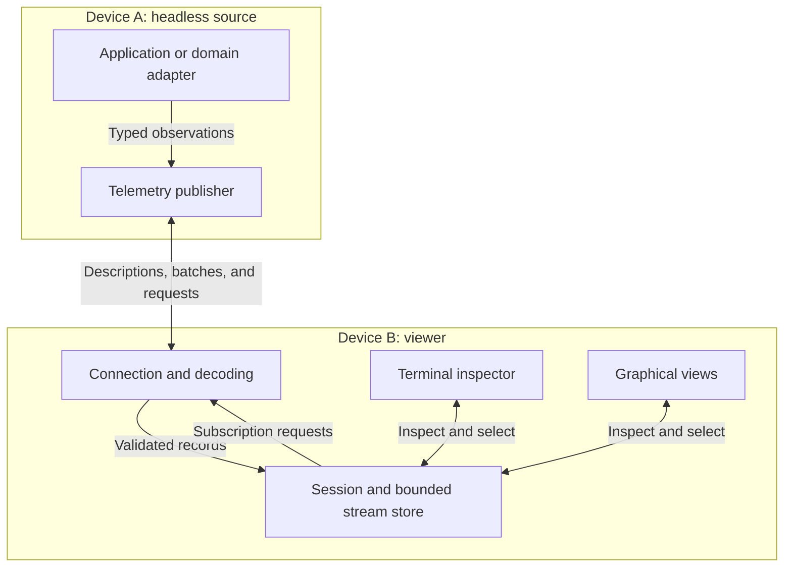

# Telemetry Visualizer: Minimal Architecture

**Status:** Ongoing Development.
**Current goal:** Visualize and inspect telemetry from local or remote headless data producers.
**Potential:** Debugger that allows for systems level debugging (visually) via a TUI or GUI by potentially producing an environment which allows for deep analysis and effects of the full system.
**Implementation:** Zig, no third-party framework dependencies (may change), fewer than 10,000 lines of project-owned implementation.

- Note: The word "telemetry" can be replaced with "data" as this matures.

## 1. Purpose and motivation

Build a small personal tool that makes runtime behavior visible. Producers describe their data, a shared model retains a bounded view of it, and terminal or graphical interfaces make that data inspectable.

The immediate purpose is observational debugging: examining values, relationships, geometry, timing, and changes while a system runs. This should be useful for my professional work, learning unfamiliar systems, experimenting, and having fun.

| Development | Example telemetry |
| --- | --- |
| Point rendering | Framebuffers, pixel buffers, point clouds, custom point maps, damage regions, display modes, page flips, point arenas (frame, LAS, etc.) |
| Robotics | Drones, positions, heading, path planning, attitude, sensor observations, coordinate transforms, trajectories, planning results, calculating avoidance, radio data via SDR, and timing |
| Networking | Packet counts, packet size, transport types, protocol formats, throughput, latency samples, queue depths, connection states, port to client/server inference, and packet injection analysis |
| Media | RTSP, SDP, RTP, RTCP, H.264, KLV, MPEG-TS, NAL Units, KLV Units, frame timing, buffering statistics, dropped-frame counts, decoded image frames, target from video analysis, avoidance calculating from video, las generation from video, custom per pixel data formats |
| Writing a kernel | Scheduler events, allocation counters, interrupt counts, queue state, virtual memory spaces vs. real memory spaces, and traces exported through a suitable bridge |
| Learning and personal experiments | Any small program whose behavior becomes easier to understand through values, plots, logs, or geometry |

These examples should be able to guide the generic data vocabulary (although unspecified as of writing). Source-specific decoding and interpretation belong in the producer or an adapter. A kernel bridge, media decoder, or robotics protocol adapter should translate its output into the same records. "Nailed down" vocabulary is below:

- Data is the actual bits like the 0's and 1's.
- Point is the generic term which can translate to pixels, coordinates, etc., depending on context.
- Record is a real time data that has been captured and recorded. It's made up of a single snapshot or many snapshots from a single data plane to multiple data planes, and should be composable. It's composed of a retention type (volatile/persistent/ephemeral), where volatile means memory like RAM, persistent means long term storage like disk/ssd/nvme, and ephemeral means immediate capture and release. An example is capturing and printing out values to then release the buffer that stored the data.

Vocabulary that needs refinement:

- Networking
- Packet header, body, payload, transport, protocol, etc.
- Media to include streams, descriptors, layers, etc. (RTSP, SDP, RTP, RTCP)
- Sensors... Too many of these like radio, LIDAR, GPR, etc. I think the closest abstraction I can think of is wave characteristics, propogation medium, and analysis, but I know I'm not getting it all yet.

### Potential Inspiration

- **GDB:** Need to look into
- **LLDB:** Need to look into
- **RAD Debugger:** Need to look into

These are design influences. The current feature set is telemetry visualization.

## 2. Narrowed scope

The first usable version should provide:

- One local or remote headless source connection carrying multiple independent streams.
- Stream discovery and descriptions.
- Scalar values and bounded time-series plots.
- Text and log inspection of incoming data.
- Basic 2D/3D points, point arrays, and geometry.
- Raw image frames in explicitly supported pixel formats.
- An extremely minimal terminal and graphical interface (only 1 for each) over the same data model.
- Selection, filtering, timestamps, stream status, and visibly lossy information.
- Explicit limits on memory, record sizes, histories, and work per update.
- Plugabble backend data via sending to a dedicated port, conforming to a specific, minimal, binary format over UDP.

Recent history lives in memory and dumps to a file to ensure seamless debugging for the debugee or the debugger, where each should have their own memory arena and history file. Initial deployment targets Linux x86-64 and ARM64. The core remains isolated from operating-system and display details.

### Deferred scope

Process launch and control, attaching to processes, breakpoints, stepping, memory/register inspection, symbols, stack unwinding, expression evaluation, persistent recording/replay, full terminal emulation, RTSP playback, media codecs, dynamic plugins, and a general GUI framework are deferred.

Future additions must justify their implementation cost against the same size ceiling. They do not require placeholder subsystems in the initial design, as this is for my personal work and projects.

## 3. Runtime architecture

The source runs on Device A; the viewer runs on Device B. They may also run on the same device.

### Headless source

The source owns application state and exposes telemetry. Its publisher can be a small module inside the application or a separate adapter executable.

A dedicated debugger agent is unnecessary for this scope. A relay can be introduced later when an actual aggregation or transport requirement calls for it.

The source performs domain-specific work: decoding a sensor protocol, interpreting compositor events, or obtaining decoded video frames. Publishing has bounded cost and never waits for the viewer's rendering loop. One of the focal points is real time systems where piping hot data is mostly what we care about.

### Viewer

The viewer receives records, validates them, updates bounded storage, and presents the result. Both interfaces use identical stream identities, values, timestamps, and retention rules.

Terminal commands inspect and filter telemetry. The graphical interface adds plots, cameras, images, and spatial selection. Freezing the displayed data leaves collection running.

Local and remote operation use the same session behavior. Presentation mode does not change telemetry semantics.

## 4. Small core abstractions

| Abstraction | Responsibility |
| --- | --- |
| `Source` | One connection and producer lifetime |
| `StreamDescriptor` | Identity and metadata needed to interpret one stream |
| `Record` | A timestamped, sequenced observation or complete data frame |
| `Store` | Bounded current state and recent history |
| `View` | Terminal or graphical interpretation of stored data |
| `Transport` | Connection lifecycle and framed byte delivery |
| `Platform` | Native input and pixel presentation where required |

Use ordinary structs, enums, tagged unions, and explicit functions. Introduce a vtable only when implementations genuinely need to vary at runtime.

Keep the producer interface procedural and small:

- Declare a stream.
- Publish a value, sample, log, or geometry/image frame.
- Replace or remove a persistent geometry object.
- Close a stream.

Publishing must define whether input bytes are copied or consumed before returning, and report dropped data. The viewer retains owned data rather than pointers into temporary receive buffers.

## 5. Telemetry model

### Stream descriptions

Each stream has a numeric ID, descriptive name, record kind/schema version, units where applicable, coordinate convention where applicable, and source clock identity to enable synchronization across all streams.

Names are labels. Identity is scoped by source lifetime and stream ID. Persistent geometry adds an object ID inside that stream.

Metadata is sent during discovery or when a description changes. Frequent updates use numeric IDs.

Start with a finite set of explicit record layouts. Application types are converted into those layouts by the producer; arbitrary language reflection is outside the initial scope.

### Record families and retention

| Family | Examples | Storage rule |
| --- | --- | --- |
| Current value | Temperature, queue depth, connection state | Replace the previous value |
| Sample history | Latency, signal power, position samples | Append to a bounded ring |
| Text/log | Diagnostic message, application event | Append to a bounded ring |
| Geometry | Points, point arrays, paths | Replace by object ID or complete frame |
| Image | A decoded frame with dimensions and format | Retain the latest complete frame |

Multiple streams of the same kind must coexist. Two cameras have separate image state; two point-cloud producers have separate frame state.

Geometry uses declared units and coordinate frames. Image records describe dimensions, stride, and pixel format. Arrays share frame metadata rather than repeating labels and timestamps for every element. It should be up to the implementation to describe whether it's world space, camera space, object space, in reference to what, etc.

### Time, ordering, and completeness

Records carry a sequence number and source timestamp. The viewer records arrival time separately.

Plots use source timestamps. Different devices' monotonic clocks are not assumed to share an origin; cross-device clock synchronization is deferred.

Sequence gaps and dropped-record counts remain visible. Bounded history is presented as bounded history.

Large frames have an identity and completion boundary. The viewer replaces the visible frame only after receiving a complete, validated replacement. If a frame becomes unavailable during transfer, abandon it and request a newer one.

## 6. Connection and Sockman

### First remote path

Use one reliable, ordered TCP connection with Sockman carrying a narrow telemetry application profile. Multiplex the selected streams over that connection.

The profile permits discovery, subscription, metadata/current-state reads, and bounded sample or frame-chunk reads. Its commands concern telemetry access.

Sockman supplies useful session identities, epochs, handles, discovery, access rules, request correlation, and state-change notifications. The telemetry profile supplies record kinds, timestamps, sequence numbers, retention, and frame semantics.

### Sample delivery

The supplied Sockman 0.0.1 protocol defines coalescible notifications with no sample payload. Use those notifications as wakeup hints:

1. The producer appends samples to bounded stream storage.
2. A notification indicates that data may be available.
3. The viewer requests a batch after its last sequence number.
4. The source returns records, the next cursor, and any gap information.

Current-value streams may return only their latest value. Histories return retained samples. Images and large arrays use bounded chunk reads tied to a stable frame ID.

This avoids a separate read for every sample. Sockman object revisions and publication times retain their existing meanings; telemetry sequence numbers and acquisition timestamps are explicit application data.

On reconnect, refresh the catalog and current state. Discard stale handles when the source epoch changes. Report unavailable history rather than inventing continuity.

### Protocol boundaries

Sockman's current native ABI targets LP64 little-endian systems. Its fixed arena, 4 KiB objects, and bounded logical transfers remain implementation constraints. Large images and arrays require application-level chunking.

The supplied ABI/helpers still need a source-side transport and request executor; include that work in the size budget.

Keep Sockman layout out of the store and renderer. Encode telemetry payloads with fixed-width fields, a specified byte order, explicit lengths, and defined floating-point formats. Wider platform support will require an appropriate versioned outer wire encoding or adapter before claiming compatibility.

Shared-memory optimizations and additional bulk transports are deferred.

## 7. Rendering, portability, and size

Reuse the existing `Scene`, `Canvas`, cameras, and drawing functions where useful. Move incoming data through the shared store before presentation.

The graphical interface uses a fixed set of panels. A selected point or sample resolves to its underlying record. An optional object-ID picking buffer is sufficient for graphical inspection.

Terminal mode does not allocate graphics buffers. Its initial interface can be a simple command prompt and formatted output.

The portable core owns decoding, validation, data storage, selection, and software rendering. Native code owns input and presentation. The initial graphical backend can remain the Linux framebuffer; ordinary desktop windows require their own display integration.

“No third-party dependencies” permits the Zig standard library and native operating-system facilities. The existing libc boundary can remain initially. Producer-specific integrations may have their own dependencies; the visualizer accepts their normalized output.

### Resource rules

- Bound stream count, history length, frame size, reassembly memory, and queued bytes.
- Limit ingestion work per iteration so input cannot monopolize presentation.
- Replace obsolete pending state and frames under pressure.
- Report history loss and malformed input.
- Allow subscriptions to reduce rate, resolution, or point count.
- Validate sizes and counts before allocation or indexing.

Keep fewer than 10,000 lines of project-owned implementation under one consistent counting rule, including required protocol/runtime code and adapters. Favor fixed views, small schemas, static imports, and explicit functions.

## 8. First milestone

A headless producer on one device publishes scalar samples, logs, geometry, and a raw image. A second device inspects them through either the terminal or graphical interface.

The milestone is complete when:

1. Both interfaces agree on values, identities, timestamps, and loss information.
2. Two streams of the same kind coexist without collisions.
3. Plots reflect sample timing rather than arrival order or uniform sample spacing.
4. Images and geometry frames appear only after complete transfer.
5. Disconnect/reconnect restores a usable catalog and current state.
6. A slow viewer leaves memory bounded and exposes dropped data.
7. Source-specific adapters can be removed while the core remains usable with synthetic or real telemetry.

## References

- [GDB: Connecting to a Remote Target](https://sourceware.org/gdb/current/onlinedocs/gdb.html/Connecting.html)
- [LLDB: Remote Debugging](https://lldb.llvm.org/use/remote.html)
- [RAD Debugger: Project and Architecture Overview](https://github.com/EpicGames/raddebugger/blob/master/README.md)
- [Sockman protocol/API file](https://github.com/1337est/nvim/blob/main/assets/zig/zag/sockman/src/main.zig)
    - TODO: Update when properly put into it's own repo...

